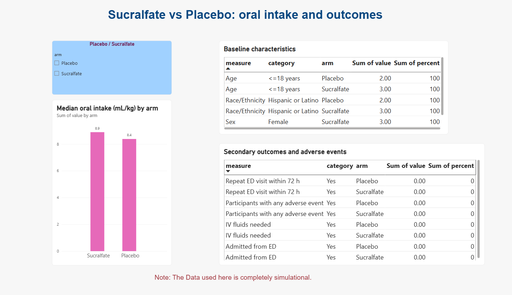

# mock-clinical-trial-data-analysis-simulated
# Simulated Clinical Trial Dashboard: Sucralfate vs Placebo

A simulated trial (5 participants, no real patient data) built to show an end-to-end clinical data workflow.

## Workflow
1. **Castor EDC**: built the study and exported simulated data.
2. **SQL (SQLite)**: calculated results (median oral intake, baseline counts, secondary outcomes, adverse events) in the layout of ClinicalTrials.gov record NCT03241030.
3. **Power BI**: built a dashboard from the SQL output.

## Files
- `study_results_setup.sql`: creates the study table and loads the data
- `trial_results_query.sql`: produces the results table
- `results_mock_simulated_CT.csv`: query output used by Power BI
- `mock_CT_1.db`: SQLite database with the simulated data
- `Mock_CT_Dashboard.pbix`: the Power BI dashboard

## Note
All data is simulated. Results show the method only, not a clinical finding.
